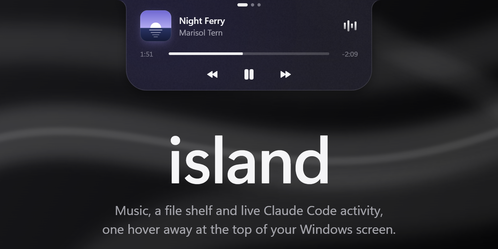
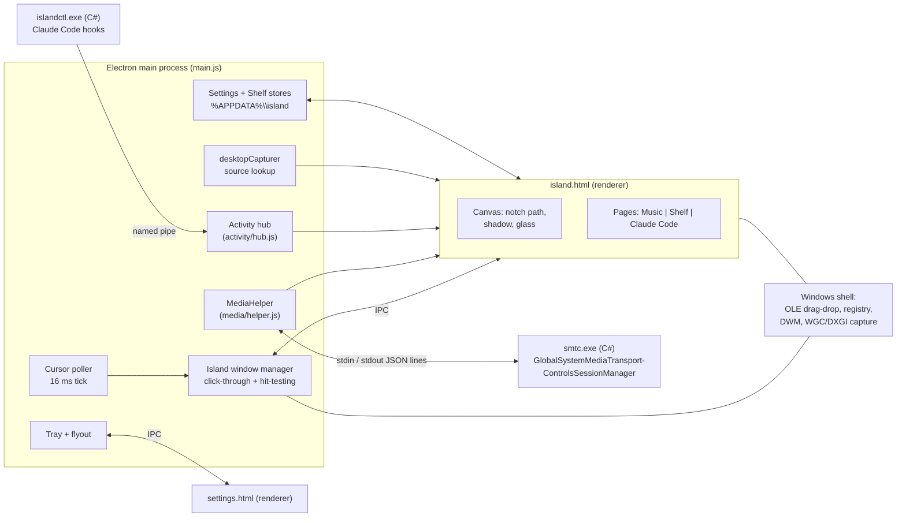
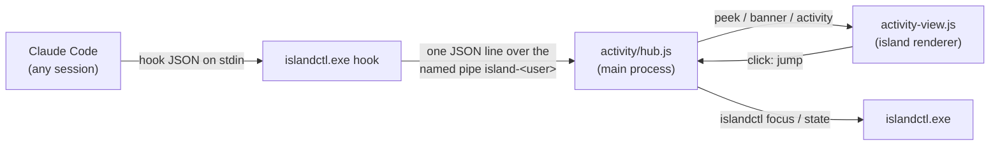

<div align="center">


# island

**A Dynamic Island for Windows.**<br>Rest your cursor on the top edge of the screen: music, a file shelf and live Claude Code activity spring out of the bezel.

[](https://github.com/yatinannam/island/releases/latest) [](https://github.com/yatinannam/island/releases)   [](LICENSE)

[**Download for Windows**](https://github.com/yatinannam/island/releases/latest) &nbsp;·&nbsp; [Features](#features) &nbsp;·&nbsp; [Claude Code](#live-activities-for-claude-code) &nbsp;·&nbsp; [How it works](#how-it-works) &nbsp;·&nbsp; [Build](#build-from-source)

<br>



</div>

<br>

## Features

<table>
<tr>
<td width="50%" valign="top">

<h3>Now playing, from any app</h3>
<p>Spotify, browsers, Media Player: anything in Windows' media controls. Artwork, live progress, play, pause, skip, and click or drag to seek. The bars move with the music that is actually playing, bass to treble.</p>
</td>
<td width="50%" valign="top">

<h3>A shelf for your files</h3>
<p>Drop files, folders or images from a browser on the island and drag them out into any app later. Long press or Ctrl+click to pick several and drag them out together.</p>
</td>
</tr>
<tr>
<td width="50%" valign="top">

<h3>Live activities for Claude Code</h3>
<p>Every Claude Code session on one page: working (with elapsed time), needs you, finished. Windows has no Live Activities for apps; island builds them from Claude Code hooks.</p>
</td>
<td width="50%" valign="top">


<h3>Peeks</h3>
<p>When a task finishes or Claude needs you, the closed island drops a small pill on its own, with a soft chime. Click it, or press <kbd>Ctrl</kbd>+<kbd>Alt</kbd>+<kbd>J</kbd>, to jump to that terminal.</p>
</td>
</tr>
</table>

**And also**

- **Real glass.** The island blurs whatever is behind it like Windows' own acrylic, tinted by the song's artwork. It follows your light/dark theme and the *Transparency effects* switch; a Solid look is one click away.
- **Feels physical.** Opening, closing and page changes run on simulated springs, and the island grows out of the top edge with concave "ears", like a notch.
- **Stays out of your way.** It never takes focus from the app you are typing in, lets every click through while closed, and holds its peeks while you watch something fullscreen or have Do Not Disturb on.
- **Light.** About 1.5% of one CPU core while idle, no network requests, everything stays on your PC.

## Install

1. Download **`island-setup-<version>.exe`** from the [latest release](https://github.com/yatinannam/island/releases/latest) (x64).
2. Run it. It installs for your user only (no admin) into `%LOCALAPPDATA%\Programs\island`, adds a Start menu entry and starts island. Earlier versions are updated in place, keeping your settings and shelf.
3. Rest your cursor on the top-center edge of the screen.

> [!NOTE]
> The installer is not code-signed, so SmartScreen may show *Windows protected your PC*: choose *More info* → *Run anyway*. Check the download against the SHA-256 in the release notes first:
>
> ```powershell
> Get-FileHash .\island-setup-0.3.0.exe -Algorithm SHA256
> ```

Requires Windows 10 1809+ or Windows 11. Your data lives in `%APPDATA%\island` (`settings.json`, `shelf.json`, `shelf-files\`); uninstalling (*Settings → Apps*) leaves it in place.

## Using island

| To | Do this |
|---|---|
| Open the island | Rest the cursor on the top-center edge of the screen |
| Switch between Music, Shelf and Claude Code | Swipe or scroll on the island (the pages follow your fingers), or click the dots at the top |
| Seek | Click or drag the progress bar |
| Keep files on the shelf | Drop them on the island (it jumps to the Shelf page) |
| Use them | Drag a file out into any app; double-click to open it |
| Go to the Claude session that needs you | Click its pill, or <kbd>Ctrl</kbd>+<kbd>Alt</kbd>+<kbd>J</kbd> |
| Pin the island open | <kbd>Ctrl</kbd>+<kbd>Alt</kbd>+<kbd>I</kbd> |
| Settings | Click island's tray icon |
| Quit | <kbd>Ctrl</kbd>+<kbd>Alt</kbd>+<kbd>Q</kbd>, or right-click the tray icon |

Settings cover Glass or Solid, transparency, song color, open and close delays, Start with Windows, keeping the tray icon on the taskbar, clearing the shelf, and Claude Code.

## Live activities for Claude Code

Off by default: without it the island has only Music and Shelf. Click island's tray icon and turn on **Claude Code**. island adds its hooks to `~/.claude/settings.json` (or `%CLAUDE_CONFIG_DIR%settings.json`; backed up first; your other hooks, plugins and settings are kept) and the Claude Code page appears. Turning it off removes exactly those hooks, the page and <kbd>Ctrl</kbd>+<kbd>Alt</kbd>+<kbd>J</kbd>. Running Claude Code sessions pick it up on their own.

| When a session… | The island |
|---|---|
| is working | lists it on the Claude Code page with the elapsed time |
| finishes a task of 10 s or more | drops a green **finished** pill for 5 s, with a rising chime |
| needs you (a permission prompt, a question) | drops an amber **needs you** pill that stays until Claude moves on, or you click or dismiss it |
| runs subagents | counts them on the session's row |
| is closed | marks it closed |

It stays quiet when you are already looking at that session's terminal, and holds peeks while a fullscreen app, a presentation or Do Not Disturb is on, or the PC is locked; they show afterwards without a chime. While the island is open, news slides in as a one-line banner. *Sounds* turns the chimes off.

Peeks show only the project folder, the status and the tool name: never your prompts or code. The events travel from Claude Code to island over a local pipe that only your Windows account can write to. Turn **Claude Code** off before uninstalling island.

## How it works

island is an Electron app with one always-on-top, transparent, click-through window at the top of the screen, a main process that watches the cursor, and two small C# helpers compiled with the C# compiler that ships with Windows.



| Process / window | Role |
|---|---|
| **Main** (`main.js`) | Polls the cursor, opens/closes the island, toggles click-through, owns the tray, settings, shelf store, media helper and activity hub, answers IPC. |
| **Island window** (`island.html` + `preload.js`) | Frameless, transparent, always-on-top, `focusable: false`, `backgroundThrottling: true`, `setContentProtection(true)` in glass mode. Draws the notch on a canvas and hosts the Music, Shelf and Claude Code pages. |
| **Settings flyout** (`settings.html` + `settings-preload.js`) | 360 px frameless window with `backgroundMaterial: 'acrylic'`, placed like Windows' own tray flyouts; hides on blur. |
| **`smtc.exe`** (`media/smtc.cs`) | Child process bridging WinRT media APIs. Exits when its stdin closes. |
| **`islandctl.exe`** (`activity/islandctl.cs`) | Run by Claude Code hooks; also reads the foreground window and Do Not Disturb state, and brings a terminal to the front. |

All renderers run with Electron defaults: `contextIsolation: true`, `sandbox: true`, `nodeIntegration: false`. Preloads expose a small `contextBridge` API (`window.island`, `window.settings`) and nothing else. No remote content is loaded.

<details>
<summary><b>The island window</b>: geometry, lifecycle, the dead-clicks fix, hit-testing, springs</summary>

<br>

**Geometry (DIP).** Shape 380×140 (`SHAPE_W`/`SHAPE_H`). Window 476×264: horizontal padding of 48 px and bottom padding sized for spring overshoot, the 14 px concave ears and the drop shadow. Positioned at the top center of the display under the cursor. Electron creates this frameless transparent window a few DIP too wide, so its bounds are set once more after creation (otherwise the island sat 3 px right of center). The notch path's top edge runs 2 px above the window: drawn exactly on y=0, anti-aliasing left the first pixel row about 75% opaque.

**Lifecycle.** The window is shown on first open and then **never hidden or moved** (it is only re-positioned when the island opens on a different display). While closed it is fully transparent and click-through. Hiding it with `hide()`/`showInactive()` or parking it off-screen after a click caused Chromium to stop delivering mouse presses to the window on later opens (pointer moves still arrived), so the controls went dead after first use.

**Why clicks died (and the fix).** With `backgroundThrottling: false`, Electron never tells Chromium the page was hidden. When Windows hides the window anyway (display off in Modern Standby, lock screen, fully covered, `hide()`), Chromium hides its input child window (`Chrome_RenderWidgetHostHWND`) and only re-shows it on the page-shown path, which then never runs. Clicks land on the top-level window instead, which answers `WM_MOUSEACTIVATE` with `MA_NOACTIVATEANDEAT` because the window can't be activated: Windows drops the button-down, so no click reaches the page. The island window therefore keeps `backgroundThrottling` on; this fixed dead controls after the PC wakes from sleep.

**Open/close.** The main process polls `screen.getCursorScreenPoint()` every 16 ms:

| Parameter | Value |
|---|---|
| Hot zone | 240×3 DIP centered on the top edge of the display under the cursor |
| Open delay (dwell in hot zone) | `openDelay`, default 150 ms (prevents opening when the cursor passes through to a browser tab) |
| Close delay (outside the shape + 10 px tolerance) | `closeDelay`, default 120 ms |
| Pinned / held | Ctrl+Alt+I pins; dragging the progress bar sends `hold` and keeps it open |

**Click-through.** `setIgnoreMouseEvents(true)` by default; the tick calls `setIgnoreMouseEvents(false)` only while the cursor is inside the shape rectangle (or the peek pill, or while held). Electron's `{ forward: true }` mouse forwarding never reached the page on Windows, so hit-testing is decided in the main process instead of the renderer.

**Animation.** A damped harmonic oscillator is integrated at startup (semi-implicit Euler, dt = 1/600 s) and sampled into a CSS `linear()` easing with 65 stops, so CSS transitions move like real springs:

| Spring | Stiffness | Damping | ~95% settled |
|---|---|---|---|
| Open | 240 | 21 (≈6% overshoot) | 180 ms |
| Close | 560 | 48 (critically damped) | 210 ms |
| Page roll | 300 | 27 | — |

Width and height transition on `.island`; a `requestAnimationFrame` loop reads its rect each frame and repaints the canvas silhouette until the size is stable for 6 frames, then sleeps.

</details>

<details>
<summary><b>Glass rendering</b>: how a transparent window blurs what is behind it</summary>

<br>

`backdrop-filter` in a transparent Electron window has no backdrop to blur, and DWM acrylic (`backgroundMaterial`, `SetWindowCompositionAttribute`) only fills a rectangle, or an aliased `SetWindowRgn` shape. island therefore composites its own acrylic:

1. **Exclude itself from capture.** `setContentProtection(true)` (`WDA_EXCLUDEFROMCAPTURE`) removes the window from screen capture, so it can capture what is behind it without feedback. Side effect: the island is invisible in screenshots and recordings in glass mode.
2. **Capture.** `desktopCapturer` resolves the screen source for the display; the renderer opens `getUserMedia({ chromeMediaSource: 'desktop' })` at 1/3 of the display resolution and ≤15 fps. Capture starts on open (or when a peek shows) and stops 4 s after close; frames arriving while closed are ignored.
3. **Crop and blur.** Per captured frame (`requestVideoFrameCallback`), the window's region plus a 2.5×blur-radius margin is drawn into an offscreen canvas. Rows above the top of the display don't exist, so the first real row is stretched upward to keep the blur edge solid. A second canvas applies `blur(22 px · scale) saturate(1.4)`.
4. **Composite** inside the notch `Path2D` (body + concave ears): blurred backdrop → `luminosity` blend layer → tint → song tint (uniform wash + radial glow from the artwork) → 2.2% noise → 1 px inner hairline (skipping the top edge). The *Transparency* setting thins the luminosity and tint layers.
5. **Theme.** `SystemUsesLightTheme` and `EnableTransparency` are read from `HKCU\Software\Microsoft\Windows\CurrentVersion\Themes\Personalize` on each open and on `nativeTheme` updates. With transparency off, the island is solid.

The song color is the most vivid hue bin of a 24×24 downsample of the artwork (12 hue bins weighted by saturation² and mid-lightness), converted to a UI accent and a deeper material tint, and interpolated between tracks.

</details>

<details>
<summary><b>Media bridge</b> (<code>smtc.exe</code>): Windows' media sessions, without an SDK</summary>

<br>

`media/smtc.cs` is a C# 5 console program compiled **without any SDK**: `media/helper.js` invokes the .NET Framework compiler that ships with Windows (`%WINDIR%\Microsoft.NET\Framework64\v4.0.30319\csc.exe`) against `System.Runtime.dll`, `System.Runtime.InteropServices.WindowsRuntime.dll` and the `System32\WinMetadata\Windows.{Foundation,Media,Storage}.winmd` contracts. `WindowsRuntimeSystemExtensions.AsTask` is unavailable without the SDK's union metadata, so `IAsyncOperation<T>` is awaited by polling `Status` (5 s timeout). Development builds compile it on first run into `media/bin/`; the installer ships it prebuilt as `resources/smtc.exe`.

It follows `GlobalSystemMediaTransportControlsSessionManager.GetCurrentSession()` (falling back to any playing session), subscribes to `MediaPropertiesChanged`, `PlaybackInfoChanged` and `TimelinePropertiesChanged`, and coalesces bursts with a 60 ms debounce.

**stdout**: one JSON object per line (UTF-8):

| `type` | Fields |
|---|---|
| `state` | `app`, `title`, `artist`, `album`, `status` (`playing`/`paused`/`stopped`/`changing`/`opened`/`closed`), `position`, `duration` (ms), `updatedAt` (Unix ms of the position sample), `canToggle`, `canNext`, `canPrev`, `canSeek`, or `{ "type": "state", "none": true }` |
| `art` | `key` (app\|title\|artist\|album), `mime`, `data` (base64 thumbnail or `null`; retried on the next event when an app publishes the title before the artwork) |
| `error` | `message` |

**stdin**: one command per line: `toggle`, `next`, `prev`, `seek <ms>`.

The renderer extrapolates position as `position + (now − updatedAt)` while playing, applies play/pause and seeks optimistically, and ignores positions reported in the 1.5 s after a seek for the same track. `MediaHelper` restarts the helper with linear backoff (up to 5 times).

</details>

<details>
<summary><b>Equalizer</b> (<code>eq.js</code>): bars that follow the system audio</summary>

<br>

1. **Capture.** `getUserMedia` with `chromeMediaSource: 'desktop'` for audio is Chromium's WASAPI loopback of the default output device: the mix Windows plays, not a microphone. Audio-only requests hang, so it also asks for a 16×16, 1 fps desktop video track and stops it immediately; the audio track stays live.
2. **Analysis.** An `AudioContext({ sinkId: { type: 'none' } })` (no output stream of its own) feeds an `AnalyserNode` (FFT 2048). Each frame, mean power in four bands (40–160, 160–600, 600–2400, 2400–10000 Hz) is scaled against that band's own 1 s average and spread, so every bar moves on loud, compressed songs and quiet ones alike; rise and fall are smoothed (30 / 90 ms).
3. **Lifecycle.** A `MutationObserver` runs it while the body has `open` and `playing`; capture stops 4 s after either ends. Before the first sound, if capture fails, and after 1.5 s of silence, the bars fall back to the CSS animation. Live bars get `will-change: transform` so new heights only update compositor layers.

</details>

<details>
<summary><b>File shelf and pages</b>: drag and drop in both directions, scrolling between pages</summary>

<br>

The island never changes size: Music, Shelf and (when it is on) Claude Code are pages. Swipe or scroll on the island, or click the dots at the top. `paging.js` moves the pages with a spring: while the fingers are down it chases their position (critically damped, ×0.75 of the wheel deltas, at most one page), and when they lift (Chromium sends one wheel event with no delta) it settles on the page the position plus the finger speed points to (a quarter page is enough), carrying its speed. One page per swipe: the touchpad's momentum after the lift is ignored; a new swipe counts once the deltas kick back in (2.5× the last step and at least 20) or turn the other way, from 150 ms after the lift, or after a 200 ms pause, because a quick next swipe starts before the last one's momentum has ended. A mouse wheel click (`wheelDelta` a multiple of 120, unlike a touchpad's) is one page. Tuned by replaying 874 recorded touchpad events (25 swipes, all landing where meant). Sideways over an overflowing shelf scrolls the files and a long session list scrolls itself, each until its end, then the pages move (not on the momentum that carried them there). The shelf dot shows the file count, and the Claude Code dot the number of sessions working or needing you. Every open starts on Music (on Claude Code when opened from a peek); a file dragged over the island switches to Shelf.

- **Drop in.** Because the window takes the mouse while the cursor is over the shape, OLE drags from Explorer reach Chromium's drop target. Paths come from `webUtils.getPathForFile()` in the preload. Files without a path (in-memory blobs) are sent as `ArrayBuffer` (≤200 MB) and written to `%APPDATA%\island\shelf-files\<uuid>\<name>`.
- **Store.** `shelf.js` keeps references, not copies, in `shelf.json` (max 50 items, oldest evicted). Items whose file no longer exists are pruned on open and after drag-out. Only files under `shelf-files` are ever deleted by the app.

  ```json
  [{ "id": "uuid", "path": "C:\\...\\file.png", "name": "file.png", "dir": false, "temp": false, "addedAt": 1794034087404 }]
  ```
- **Thumbnails.** `nativeImage.createThumbnailFromPath` (Windows shell thumbnails: images, video, PDF), falling back to `app.getFileIcon`.
- **Drag out.** The renderer cancels Chromium's `dragstart` and asks the main process, which calls `webContents.startDrag({ files, icon })`: a real `CF_HDROP` (`FileDrop`) data object, so the drop target decides copy or move like an Explorer drag.
- **Multi-select.** A 400 ms stationary long press (or Ctrl+click) enters select mode; clicks toggle; dragging a selected tile drags every selected file; *Done*, a drag-out or closing the island exits. Moving before 400 ms is an ordinary single-file drag.

</details>

<details>
<summary><b>Live activities internals</b>: hooks, the pipe, peek rules</summary>

<br>

Each hook runs `islandctl.exe hook` in exec form (no shell) with `async: true`, so Claude Code never waits for it.



1. **`islandctl.exe`** (`activity/islandctl.cs`, C# 5, GUI subsystem so it never flashes a console). `hook` reads the hook JSON, keeps only a few top-level string fields (a small scanner skips `tool_input` / `tool_response`), finds the Claude process (first non-shell ancestor) and its terminal window (`AttachConsole` + `GetConsoleWindow`; in Windows Terminal that is a hidden pseudo-console window owned by the terminal's window, so `GetAncestor(GA_ROOTOWNER)`), and writes one line to the pipe. It never prints, always exits 0, and gives up at once when no island is listening. About 85 ms per run, in the background.
2. **Hooks used.** `UserPromptSubmit` (working), `Stop` / `StopFailure` (finished / ended on an error), `Notification` (`permission_prompt`, `elicitation_dialog`: needs you; `idle_prompt`, Claude's "still waiting" reminder a minute after it finished, is ignored: that session is just finished), `PermissionRequest` (which tool the prompt is for), `PostToolUse` / `PostToolUseFailure` / `PermissionDenied` (Claude moved on: clears needs-you), `SubagentStop` (counted), `SessionEnd`.
3. **Hub.** One session per `session_id`, labelled by the project folder (`island`, `island 2` for a second session in the same folder). A session ends as *closed* when its Claude process exits. Peeks follow these rules:
   - *Finished* peeks for 5 s, only if the turn took 10 s or more and its terminal is not the foreground window. *Needs you* always peeks and stays until that session moves on, the pill is clicked, or dismissed with its x. A row's x on the Claude Code page removes the session in any state; it comes back with its next event.
   - If island starts during a turn (an update, a restart), the first tool, permission or subagent event of a session not known to be working starts the turn, so its finish still peeks.
   - One at a time, needs-you first; a needs-you pill gives way to waiting peeks after 5 s and comes back.
   - Held while `SHQueryUserNotificationState` reports a fullscreen app, presentation or quiet time, while Do Not Disturb is on (the shell's quiet-hours WNF state; the notification state does not show it), and while the PC is locked or asleep. Held peeks show afterwards without a chime; after 30 min they are only listed.
   - While the island is open, news comes as a one-line banner instead.
   - Chimes are made with Web Audio (rising: finished; double tap: needs you; falling: error), once per peek; *Sounds* in the flyout turns them off.
4. **Pill and page.** The pill (300×40 DIP) is the same canvas silhouette as the island, sprung to a smaller size; the main tick gives it the mouse while the cursor is on it, and its timer waits meanwhile. The top hot zone still opens the island, on the Claude Code page when a peek is showing. Clicking the pill or a row, or Ctrl+Alt+J (latest needs-you, else latest finished), runs `islandctl focus <hwnd>` (`AttachThreadInput` + `SetForegroundWindow`). It brings the terminal window forward, not a specific tab.

</details>

<details>
<summary><b>Settings file</b></summary>

<br>

`%APPDATA%\island\settings.json`, validated and clamped on load, written 400 ms after the last change:

| Key | Default | Range | Meaning |
|---|---|---|---|
| `glass` | `true` | bool | Glass vs. solid background |
| `transparency` | `35` | 0–100 | Thins the acrylic luminosity/tint layers |
| `songColor` | `55` | 0–100 | Strength of the artwork tint (0 = off) |
| `openDelay` | `150` | 0–600 ms | Dwell in the hot zone before opening |
| `closeDelay` | `120` | 0–1000 ms | Time outside the island before closing |
| `claudeSound` | `true` | bool | Chimes for Claude Code peeks |
| `trayPromotedGuids` | `[]` | string[] | Internal: tray GUIDs already moved to the taskbar once |

*Start with Windows* is not stored here: it is `app.setLoginItemSettings` for the running executable (`HKCU\...\Run`). Changing a look setting holds the island open on the primary display until the flyout closes, as a live preview.

</details>

<details>
<summary><b>Tray icon</b>: drawn in code, kept on the taskbar</summary>

<br>

- **Icon.** `icon.js` renders a screen outline with the island notch from signed distance fields, 4×4 supersampled, at 16/20/24/32 px (100/125/150/200% scale), white on a dark taskbar and near-black on a light one. The same shapes produce the full-color app icon.
- **Stable identity.** Windows ties an unsigned app's tray GUID to one executable path, so the GUID is derived from `process.execPath` (SHA-1, UUID v5 layout). Development, `dist\win-unpacked` and the installed copy each get their own, stable across restarts.
- **Always visible.** New tray icons go to the `^` overflow. On first run per GUID, `tray-visibility.js` finds the icon's entry in `HKCU\Control Panel\NotifyIconSettings` by `IconGuid` (querying only that value: a full-data `reg query /f` is very slow because every entry stores a PNG snapshot) and sets `IsPromoted = 1`, re-checking after 1.5 s because Explorer may write its default right after creating the entry. Explorer applies it live. After that the setting is the user's: *Always show icon on taskbar* in the flyout, or Windows' own taskbar settings.

</details>

<details>
<summary><b>IPC reference</b></summary>

<br>

Island window (`preload.js` → `window.island`):

| Direction | Channel | Payload |
|---|---|---|
| renderer → main (invoke) | `snapshot` | → `{ config, media, art, shelf, activity }` |
| main → renderer | `island-state` | `'open'` \| `'closed'` |
| main → renderer | `open-page` | page for the next open (0 music, 2 Claude Code) |
| main → renderer | `peek` / `banner` | `{ key, session, kind, label, tool, durationMs, chime }` or `null` |
| main → renderer | `activity` | `{ connected, sessions: [{ id, label, state, needsKind, tool, turnStart, durationMs, endedAt, lastEventAt, subagents, canJump }] }` |
| main → renderer | `config` | `{ glass, dark, transparency, songColor }` |
| main → renderer | `capture` | `{ sourceId, display, window }` (bounds in DIP) |
| main → renderer | `media-state` / `media-art` | helper `state` / `{ key, url }` |
| main → renderer | `shelf` | `[{ id, name, dir, thumb }]` |
| renderer → main | `media-cmd` | `toggle` \| `next` \| `prev` \| `seek <ms>` (validated) |
| renderer → main | `hold` | `boolean` (progress-bar drag) |
| renderer → main | `shape-size` | island height for hit-testing |
| renderer → main | `shelf-add` / `shelf-add-data` | `string[]` / `{ name, bytes }` |
| renderer → main | `shelf-remove` / `shelf-open` / `shelf-clear` / `shelf-drag` | id / id / — / `string[]` |
| renderer → main | `peek-click` / `peek-dismiss` / `activity-jump` / `activity-dismiss` | session id |
| renderer → main | `debug` | string, logged when `ISLAND_DEBUG=1` |

Settings flyout (`settings-preload.js` → `window.settings`): `settings-get` (invoke), `settings-set` (partial settings), `settings-action` (`quit`, `hide`, `pin`, `start-with-windows-on|off`, `tray-shown-on|off`, `shelf-clear`, `claude-on|off`), `settings-size` (the page's natural height); main pushes `settings`, `settings-shown` and `settings-hiding` (fade the content out before the window hides).

</details>

<details>
<summary><b>Flags, environment variables, hotkeys</b></summary>

<br>

| | |
|---|---|
| `--open` | Start with the island pinned open |
| `--solid` | Force solid background for this run |
| `--settings` | Open the settings flyout on start |
| `--quit` | Quit the running copy (exits immediately if none is running) |
| `--start-with-windows on\|off` | Set the login item for this executable |
| `ISLAND_DEBUG=1` | Log open/close with cursor coordinates, presses on the island, media state, shelf and activity events |
| `ISLAND_SHOT=<file.png>` | Save `webContents.capturePage()` of the island 1.8 s after opening (the island is hidden from normal screenshots in glass mode) |
| `ISLAND_CSS=<css>` | Inject CSS into the island page (layout debugging) |
| <kbd>Ctrl</kbd>+<kbd>Alt</kbd>+<kbd>I</kbd> / <kbd>Q</kbd> | Pin or close the island / quit |
| <kbd>Ctrl</kbd>+<kbd>Alt</kbd>+<kbd>J</kbd> | Go to the terminal of the Claude Code session that needs you (else the latest one that finished) |

A second launch without flags opens the settings flyout in the running copy (single-instance lock).

</details>

## Build from source

Requires Windows 10 1809+ and [bun](https://bun.sh) 1.3 or later. No .NET SDK and no native Node modules: the C# helpers are compiled with the `csc.exe` that ships with Windows.

```powershell
git clone https://github.com/yatinannam/island
cd island
bun install          # Electron binary is fetched on first run
bun run start        # development
bun run dev          # development, island pinned open
bun run quit         # quit a running copy
bun run dist         # build the installer
```

`bun run dist` runs:

1. `scripts/build-helper.js`: compiles `media/smtc.cs` → `media/bin/smtc.exe` and `activity/islandctl.cs` → `activity/bin/islandctl.exe` with the in-box `csc.exe`.
2. `scripts/make-icon.js`: renders `build/icon.ico` (16–256 px, PNG-compressed entries) and `build/icon.png` from `icon.js`, with a dependency-free PNG/ICO encoder.
3. `electron-builder --win nsis` (26.x): `npmRebuild: false` (no native modules), `smtc.exe` and `islandctl.exe` added via `extraResources`, NSIS one-click per-user installer → `dist/island-setup-<version>.exe`.

<details>
<summary><b>Repository layout</b></summary>

<br>

```
main.js                   main process: cursor poller, windows, tray, IPC
preload.js                window.island bridge
island.html               island renderer: canvas glass, Music, Shelf and Claude Code pages
paging.js                 page swiping: follows the fingers, settles with a spring
eq.js                     equalizer bars from system audio loopback
activity-view.js          live-activity peek pill, Claude Code page, banner, chimes
activity/hub.js           live-activity sessions and peek rules (main process, named pipe)
activity/claude-hooks.js  the Claude Code switch: island's hooks in ~/.claude/settings.json
activity/helper.js        compiles and runs islandctl.exe
activity/islandctl.cs     hook bridge, foreground/DND state, window focus (C# 5)
settings.html             tray flyout UI
settings-preload.js       window.settings bridge
settings.js               settings store (validation, debounced save)
shelf.js                  shelf store
icon.js                   SDF tray/app icon renderer
tray-visibility.js        NotifyIconSettings IsPromoted read/write
media/smtc.cs             WinRT media bridge (C# 5)
media/helper.js           compiles, spawns and parses smtc.exe
scripts/                  build-helper.js, make-icon.js
docs/images/              README images
```

</details>

## Known limitations

- **Hidden from screen capture in glass mode** (content protection is what makes the blur possible). Use Solid to record the island.
- **Stays over fullscreen apps** as an invisible, click-through window, since hiding it breaks input (see *The island window*). Exclusive-fullscreen games are not overlaid at all.
- **Multi-monitor:** opening on another display moves the window, which may hit the same input bug as hiding; only single-display setups are tested.
- **Unsigned binaries:** SmartScreen warns on first run; the tray GUID is per executable path.
- **Media:** apps that don't publish to Windows' media controls (or publish no timeline) show no progress or seeking; some apps publish the title before the artwork, so art can lag by one event.
- **Live activities:** jumping brings the terminal window forward, not the exact Windows Terminal tab, and cannot bring forward an Administrator terminal. Claude Code sends no event when a turn is interrupted with Esc, so such a session shows *idle* after 2 min without news. Turn *Claude Code* off before uninstalling; otherwise its hooks keep pointing at the removed `islandctl.exe` (Claude Code reports a non-blocking hook error).

## Privacy and security

island makes no network requests. It reads what Windows' media controls publish, captures the screen behind the island only to blur it (in memory, never saved), listens to the sound your speakers play only to move the equalizer bars, and, if you connect Claude Code, receives session events over a local pipe. [SECURITY.md](SECURITY.md) lists exactly what the app touches and how to report a vulnerability.

## Contributing

Issues and pull requests are welcome. [CONTRIBUTING.md](CONTRIBUTING.md) covers the dev setup, conventions, testing hooks and release steps.

<br>

<div align="center">

**MIT licensed** · [LICENSE](LICENSE)

Inspired by [Pillar](https://github.com/warpirate/pillar-dynamic-island-for-windows) (MIT) and [notchX](https://github.com/rahozosman/notchX) (ideas only, no code used).

</div>
