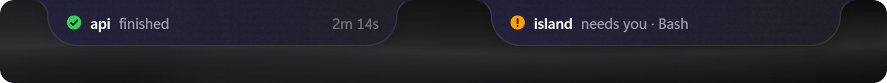
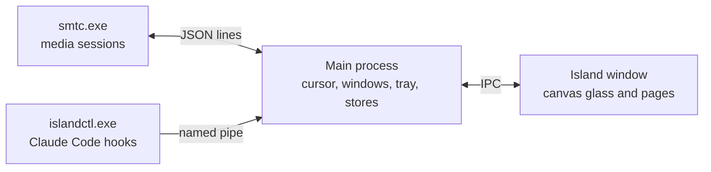

<div align="center">


# island

**A notch-style panel for the top of your Windows screen.**<br>Hover the top edge to control music, keep files at hand and follow your Claude Code sessions.

[](https://github.com/yatinannam/island/releases/latest)  [](LICENSE)

[**Download**](https://github.com/yatinannam/island/releases/latest) &nbsp;·&nbsp; [Features](#features) &nbsp;·&nbsp; [Install](#install) &nbsp;·&nbsp; [Usage](#usage) &nbsp;·&nbsp; [Claude Code](#claude-code) &nbsp;·&nbsp; [Architecture](docs/ARCHITECTURE.md)

<br>


</div>

## Features

### Music from any app

Shows what is playing in any app that uses Windows' media controls, such as Spotify, web browsers and Media Player. Play, pause, skip, and click or drag the progress bar to seek. The equalizer bars follow the audio that is playing.


### File shelf

Drop files, folders or images from a browser onto the island, and drag them into any app later. Long-press a file or Ctrl+click to select several and drag them out together.


### Claude Code sessions (optional)

Lists your Claude Code sessions and what each one is doing: working, waiting for your input, or finished. Off by default; turn it on in Settings.


When a task finishes or Claude needs your input, the closed island shows a small notification, a *peek*. Click it, or press <kbd>Ctrl</kbd>+<kbd>Alt</kbd>+<kbd>J</kbd>, to switch to that session's terminal.



### More

- A glass background that blurs the desktop behind the island, like Windows acrylic, tinted by the album art. It follows light and dark mode; a solid background is available in Settings.
- Spring animations for opening, closing and switching pages. When you swipe, the pages follow your fingers and settle on the next page.
- Never takes focus from the app you are typing in, lets clicks through while closed, and holds peeks while a fullscreen app or Do Not Disturb is on.
- Updates itself from GitHub Releases while your PC is idle.
- About 1.5% of one CPU core when idle.

## Install

Requires Windows 11, or Windows 10 version 2004 or later (x64).

1. Download `island-setup-<version>.exe` from the [latest release](https://github.com/yatinannam/island/releases/latest).
2. Run it. It installs for the current user, without administrator rights, into `%LOCALAPPDATA%\Programs\island`, adds a Start menu entry and starts island. Installing over an earlier version updates it and keeps your settings and shelf. From version 0.4.0 on, island updates itself; earlier versions need this one manual install.
3. Move the cursor to the top-center edge of the screen.

> [!NOTE]
> The installer is not code-signed, so SmartScreen may show *Windows protected your PC*. Choose **More info**, then **Run anyway**. First compare the file's hash with the SHA-256 in the release notes:
>
> ```powershell
> Get-FileHash .\island-setup-<version>.exe -Algorithm SHA256
> ```

Settings and the shelf are stored in `%APPDATA%\island`. Uninstalling from *Settings > Apps* leaves that folder in place.

## Usage

| Action | How |
|---|---|
| Open the island | Move the cursor to the top-center edge of the screen |
| Switch pages | Swipe or scroll on the island, or click the dots at the top |
| Seek | Click or drag the progress bar |
| Add files to the shelf | Drop them on the island |
| Use a file from the shelf | Drag it into any app, or double-click to open it |
| Pin the island open | <kbd>Ctrl</kbd>+<kbd>Alt</kbd>+<kbd>I</kbd> |
| Open Settings | Click the tray icon |
| Quit | <kbd>Ctrl</kbd>+<kbd>Alt</kbd>+<kbd>Q</kbd>, or right-click the tray icon |

Settings include the background (glass or solid), transparency, album-art tint, open and close delays, starting with Windows, keeping the tray icon on the taskbar, clearing the shelf, Claude Code, and updates.

## Claude Code

Claude Code support is off by default. To turn it on, open Settings from the tray icon and switch on **Claude Code**. The app backs up `~/.claude/settings.json` (or the `settings.json` in `CLAUDE_CONFIG_DIR`), then adds its hooks; your other hooks and settings stay as they are. Running sessions pick up the change on their own. Switching it off removes only those hooks, along with the Claude Code page and <kbd>Ctrl</kbd>+<kbd>Alt</kbd>+<kbd>J</kbd>.

| When a session | The island |
|---|---|
| Is working | Lists it on the Claude Code page with the elapsed time |
| Finishes a task of 10 seconds or more | Shows a green peek for 5 seconds, with a sound |
| Needs your input (a permission prompt or a question) | Shows an amber peek until Claude continues, or you click or dismiss it |
| Ends | Marks it as closed |

Peeks are skipped when that session's terminal is already in front, and wait while a fullscreen app, a presentation or Do Not Disturb is on, or the PC is locked. While the island is open, updates appear as a one-line banner instead. Sounds can be turned off in Settings.

Peeks show only the project folder name, the status and the tool name, never your prompts or code. Turn Claude Code off before uninstalling, so Claude Code is not left with hooks that point to a removed program.

## Known limitations

- In glass mode the island does not appear in screenshots or screen recordings: it is excluded from screen capture so that it can blur what is behind it. Switch to the solid background to record it.
- The island's window stays above fullscreen apps, fully transparent and click-through while closed. Exclusive-fullscreen games are not overlaid.
- Tested on single-display setups only.
- Apps that don't use Windows' media controls don't appear, and apps that publish no timeline show no progress bar or seeking.
- Switching to a Claude Code session brings its terminal window forward, but not a specific Windows Terminal tab, and not a terminal running as administrator. Claude Code sends no event when a turn is interrupted with Esc, so that session shows as idle after 2 minutes.

## Privacy

The only network traffic is the update check: every 6 hours the app asks GitHub for the latest release, and downloads the installer when there is a newer one. No identifiers or usage data are sent, and turning off *Update automatically* in Settings stops it. Otherwise the app reads what Windows' media controls publish, captures the screen behind the island only to blur it (in memory, never saved), listens to your speakers' output only to move the equalizer bars, and, with Claude Code switched on, receives session events over a local pipe that only your Windows account can write to. [SECURITY.md](SECURITY.md) lists everything the app accesses and how to report a vulnerability.

## How it works

The app is built on Electron. A main process polls the cursor and opens the island; a single transparent, click-through window draws it on a canvas, including its own glass, since Windows cannot blur behind a non-rectangular window. Two small C# helpers, compiled with the C# compiler that ships with Windows, read Windows' media sessions and receive Claude Code's hooks.



[docs/ARCHITECTURE.md](docs/ARCHITECTURE.md) covers the design in detail: the window and input handling, glass rendering, the media bridge, the equalizer, swiping, the shelf, the Claude Code hooks, the settings file and the IPC channels.

## Build from source

Requires Windows 10 version 2004 or later and [bun](https://bun.sh) 1.3 or later. No .NET SDK or native Node modules are needed.

```powershell
git clone https://github.com/yatinannam/island
cd island
bun install
bun run start        # run in development
bun run dev          # run with the island pinned open
bun run dist         # build the installer into dist\
```

[CONTRIBUTING.md](CONTRIBUTING.md) covers conventions, testing, debugging flags and releases.

## License

[MIT](LICENSE). Inspired by [Pillar](https://github.com/warpirate/pillar-dynamic-island-for-windows) (MIT) and [notchX](https://github.com/rahozosman/notchX) (ideas only; no code used).
