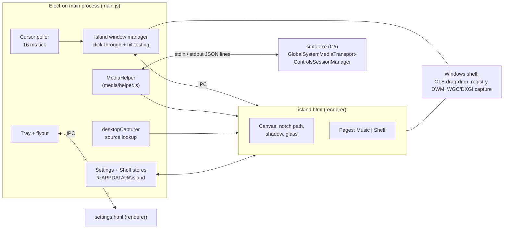

# island

A macOS-style "notch" island for Windows 10/11, built on Electron. Rest the cursor on the top-center edge of a display and a glass island springs out of the bezel with system-wide now-playing controls and a drag-and-drop file shelf.

**[Download the latest installer](https://github.com/yatinannam/island/releases/latest)** (`island-setup-<version>.exe`, x64, per-user install, no admin rights). The SHA-256 of each installer is listed in its release notes.

| | |
|---|---|
| Platform | Windows 10 1809+ / Windows 11, x64 (developed and tested on Windows 11 build 26300 at 125% scaling) |
| Runtime | Electron 45 (Chromium + Node), one 33 MB native helper for media |
| Footprint | ~1.5% of one CPU core idle; ~0.3 core while open with glass (~0.4 while music plays); ~350 MB RAM across Electron processes |
| Network | None. The app makes no network requests. |
| License | [MIT](LICENSE) |

---

## Contents

- [Features](#features)
- [Install](#install)
- [Architecture](#architecture)
- [The island window](#the-island-window)
- [Glass rendering](#glass-rendering)
- [Media bridge (`smtc.exe`)](#media-bridge-smtcexe)
- [Equalizer (`eq.js`)](#equalizer-eqjs)
- [File shelf](#file-shelf)
- [Settings](#settings)
- [Tray icon](#tray-icon)
- [IPC reference](#ipc-reference)
- [Flags, environment variables, hotkeys](#flags-environment-variables-hotkeys)
- [Build and packaging](#build-and-packaging)
- [Repository layout](#repository-layout)
- [Known limitations](#known-limitations)
- [Contributing, security, license](#contributing-security-license)

---

## Features

- **Hover-to-reveal island** attached to the top edge (concave "ears", rounded bottom corners), opened and closed with physically simulated springs.
- **Now playing** for any app that publishes to Windows System Media Transport Controls (Spotify, Chromium/Edge/Firefox media sessions, Media Player, ...): artwork, title, artist, live progress, play/pause/next/previous, click or drag to seek.
- **Live equalizer**: the four bars next to the title move with the sound actually playing (bass to treble).
- **Glass material** matching Windows acrylic (blur, luminosity, tint, noise), tinted by the current artwork ("song color"), following the system theme and the *Transparency effects* switch. A solid mode is available.
- **File shelf** on a second page: drop files, folders or in-memory blobs (e.g. images from a browser) on the island, drag them back out into any app; multi-select by long press or Ctrl+click.
- **Tray flyout** for settings, rendered with the native acrylic backdrop and the Windows accent color.

## Install

Run `island-setup-<version>.exe`. The NSIS one-click installer installs per-user to `%LOCALAPPDATA%\Programs\island`, creates a Start menu shortcut, registers an uninstaller under *Settings > Apps*, and launches the app.

The installer and `island.exe` are **not code-signed**. SmartScreen may show *Windows protected your PC* on first run: choose *More info > Run anyway*. Verify the download against the SHA-256 in the release notes first:

```powershell
Get-FileHash .\island-setup-0.1.3.exe -Algorithm SHA256
```

User data lives in `%APPDATA%\island` (`settings.json`, `shelf.json`, `shelf-files\`). Uninstalling leaves it in place; delete the folder to remove it.

---

## Architecture



| Process / window | Role |
|---|---|
| **Main** (`main.js`) | Polls the cursor, opens/closes the island, toggles click-through, owns the tray, settings, shelf store and the media helper, answers IPC. |
| **Island window** (`island.html` + `preload.js`) | Frameless, transparent, always-on-top, `focusable: false`, `backgroundThrottling: true`, `setContentProtection(true)` in glass mode. Draws the notch on a canvas and hosts the Music and Shelf pages. |
| **Settings flyout** (`settings.html` + `settings-preload.js`) | 340 px frameless window with `backgroundMaterial: 'acrylic'`, positioned above the tray icon inside the work area; hides on blur. |
| **`smtc.exe`** (`media/smtc.cs`) | Child process bridging WinRT media APIs. Exits when its stdin closes. |

All renderers run with Electron defaults: `contextIsolation: true`, `sandbox: true`, `nodeIntegration: false`. Preloads expose a small `contextBridge` API (`window.island`, `window.settings`) and nothing else. No remote content is loaded.

## The island window

**Geometry (DIP).** Shape 380×140 (`SHAPE_W`/`SHAPE_H`). Window 476×264: horizontal padding of 48 px and bottom padding sized for spring overshoot, the 14 px concave ears and the drop shadow. Positioned at the top center of the display under the cursor.

**Lifecycle.** The window is shown on first open and then **never hidden or moved** (it is only re-positioned when the island opens on a different display). While closed it is fully transparent and click-through. Hiding it with `hide()`/`showInactive()` or parking it off-screen after a click caused Chromium to stop delivering mouse presses to the window on later opens (pointer moves still arrived), so the controls went dead after first use.

**Why clicks died (and the fix).** With `backgroundThrottling: false`, Electron never tells Chromium the page was hidden. When Windows hides the window anyway (display off in Modern Standby, lock screen, fully covered, `hide()`), Chromium hides its input child window (`Chrome_RenderWidgetHostHWND`) and only re-shows it on the page-shown path, which then never runs. Clicks land on the top-level window instead, which answers `WM_MOUSEACTIVATE` with `MA_NOACTIVATEANDEAT` because the window can't be activated: Windows drops the button-down, so no click reaches the page. The island window therefore keeps `backgroundThrottling` on; this fixed dead controls after the PC wakes from sleep.

**Open/close.** The main process polls `screen.getCursorScreenPoint()` every 16 ms:

| Parameter | Value |
|---|---|
| Hot zone | 240×3 DIP centered on the top edge of the display under the cursor |
| Open delay (dwell in hot zone) | `openDelay`, default 150 ms (prevents opening when the cursor passes through to a browser tab) |
| Close delay (outside the shape + 10 px tolerance) | `closeDelay`, default 120 ms |
| Pinned / held | Ctrl+Alt+I pins; dragging the progress bar sends `hold` and keeps it open |

**Click-through.** `setIgnoreMouseEvents(true)` by default; the tick calls `setIgnoreMouseEvents(false)` only while the cursor is inside the shape rectangle (or while held). Electron's `{ forward: true }` mouse forwarding never reached the page on Windows, so hit-testing is decided in the main process instead of the renderer.

**Animation.** A damped harmonic oscillator is integrated at startup (semi-implicit Euler, dt = 1/600 s) and sampled into a CSS `linear()` easing with 65 stops, so CSS transitions move like real springs:

| Spring | Stiffness | Damping | ~95% settled |
|---|---|---|---|
| Open | 240 | 21 (≈6% overshoot) | 180 ms |
| Close | 560 | 48 (critically damped) | 210 ms |
| Page roll | 300 | 27 | — |

Width and height transition on `.island`; a `requestAnimationFrame` loop reads its rect each frame and repaints the canvas silhouette until the size is stable for 6 frames, then sleeps.

## Glass rendering

`backdrop-filter` in a transparent Electron window has no backdrop to blur, and DWM acrylic (`backgroundMaterial`, `SetWindowCompositionAttribute`) only fills a rectangle, or an aliased `SetWindowRgn` shape. island therefore composites its own acrylic:

1. **Exclude itself from capture.** `setContentProtection(true)` (`WDA_EXCLUDEFROMCAPTURE`) removes the window from screen capture, so it can capture what is behind it without feedback. Side effect: the island is invisible in screenshots and recordings in glass mode.
2. **Capture.** `desktopCapturer` resolves the screen source for the display; the renderer opens `getUserMedia({ chromeMediaSource: 'desktop' })` at 1/3 of the display resolution and ≤15 fps. Capture starts on open and stops 4 s after close; frames arriving while closed are ignored.
3. **Crop and blur.** Per captured frame (`requestVideoFrameCallback`), the window's region plus a 2.5×blur-radius margin is drawn into an offscreen canvas. Rows above the top of the display don't exist, so the first real row is stretched upward to keep the blur edge solid. A second canvas applies `blur(22 px · scale) saturate(1.4)`.
4. **Composite** inside the notch `Path2D` (body + concave ears): blurred backdrop → `luminosity` blend layer → tint → song tint (uniform wash + radial glow from the artwork) → 2.2% noise → 1 px inner hairline (skipping the top edge). The *Transparency* setting thins the luminosity and tint layers.
5. **Theme.** `SystemUsesLightTheme` and `EnableTransparency` are read from `HKCU\Software\Microsoft\Windows\CurrentVersion\Themes\Personalize` on each open and on `nativeTheme` updates. With transparency off, the island is solid.

The song color is the most vivid hue bin of a 24×24 downsample of the artwork (12 hue bins weighted by saturation² and mid-lightness), converted to a UI accent and a deeper material tint, and interpolated between tracks.

## Media bridge (`smtc.exe`)

`media/smtc.cs` is a C# 5 console program compiled **without any SDK**: `media/helper.js` invokes the .NET Framework compiler that ships with Windows (`%WINDIR%\Microsoft.NET\Framework64\v4.0.30319\csc.exe`) against `System.Runtime.dll`, `System.Runtime.InteropServices.WindowsRuntime.dll` and the `System32\WinMetadata\Windows.{Foundation,Media,Storage}.winmd` contracts. `WindowsRuntimeSystemExtensions.AsTask` is unavailable without the SDK's union metadata, so `IAsyncOperation<T>` is awaited by polling `Status` (5 s timeout). Development builds compile it on first run into `media/bin/`; the installer ships it prebuilt as `resources/smtc.exe`.

It follows `GlobalSystemMediaTransportControlsSessionManager.GetCurrentSession()` (falling back to any playing session), subscribes to `MediaPropertiesChanged`, `PlaybackInfoChanged` and `TimelinePropertiesChanged`, and coalesces bursts with a 60 ms debounce.

**stdout** — one JSON object per line (UTF-8):

| `type` | Fields |
|---|---|
| `state` | `app`, `title`, `artist`, `album`, `status` (`playing`/`paused`/`stopped`/`changing`/`opened`/`closed`), `position`, `duration` (ms), `updatedAt` (Unix ms of the position sample), `canToggle`, `canNext`, `canPrev`, `canSeek` — or `{ "type": "state", "none": true }` |
| `art` | `key` (app\|title\|artist\|album), `mime`, `data` (base64 thumbnail or `null`; retried on the next event when an app publishes the title before the artwork) |
| `error` | `message` |

**stdin** — one command per line: `toggle`, `next`, `prev`, `seek <ms>`.

The renderer extrapolates position as `position + (now − updatedAt)` while playing, applies play/pause and seeks optimistically, and ignores positions reported in the 1.5 s after a seek for the same track. `MediaHelper` restarts the helper with linear backoff (up to 5 times).

## Equalizer (`eq.js`)

The bars follow the system audio, loaded as a separate script after the island's own.

1. **Capture.** `getUserMedia` with `chromeMediaSource: 'desktop'` for audio is Chromium's WASAPI loopback of the default output device: the mix Windows plays, not a microphone. Audio-only requests hang, so it also asks for a 16×16, 1 fps desktop video track and stops it immediately; the audio track stays live.
2. **Analysis.** An `AudioContext({ sinkId: { type: 'none' } })` (no output stream of its own) feeds an `AnalyserNode` (FFT 2048). Each frame, mean power in four bands (40–160, 160–600, 600–2400, 2400–10000 Hz) is scaled against that band's own 1 s average and spread, so every bar moves on loud, compressed songs and quiet ones alike; rise and fall are smoothed (30 / 90 ms).
3. **Lifecycle.** A `MutationObserver` runs it while the body has `open` and `playing`; capture stops 4 s after either ends. Before the first sound, if capture fails, and after 1.5 s of silence, the bars fall back to the CSS animation. Live bars get `will-change: transform` so new heights only update compositor layers.

## File shelf

The shelf is the island's second page; the island never changes size. Scroll on the island to roll pages (one page per gesture, 40 px delta threshold, 450 ms cooldown; sideways scroll over an overflowing shelf scrolls the tiles), or click the dots at the top. The shelf dot shows the file count while the music page is visible. Every open starts on Music; a file dragged over the island switches to Shelf.

- **Drop in.** Because the window takes the mouse while the cursor is over the shape, OLE drags from Explorer reach Chromium's drop target. Paths come from `webUtils.getPathForFile()` in the preload. Files without a path (in-memory blobs) are sent as `ArrayBuffer` (≤200 MB) and written to `%APPDATA%\island\shelf-files\<uuid>\<name>`.
- **Store.** `shelf.js` keeps references, not copies, in `shelf.json` (max 50 items, oldest evicted). Items whose file no longer exists are pruned on open and after drag-out. Only files under `shelf-files` are ever deleted by the app.

  ```json
  [{ "id": "uuid", "path": "C:\\...\\file.png", "name": "file.png", "dir": false, "temp": false, "addedAt": 1794034087404 }]
  ```
- **Thumbnails.** `nativeImage.createThumbnailFromPath` (Windows shell thumbnails: images, video, PDF), falling back to `app.getFileIcon`.
- **Drag out.** The renderer cancels Chromium's `dragstart` and asks the main process, which calls `webContents.startDrag({ files, icon })`: a real `CF_HDROP` (`FileDrop`) data object, so the drop target decides copy or move like an Explorer drag.
- **Multi-select.** A 400 ms stationary long press (or Ctrl+click) enters select mode; clicks toggle; dragging a selected tile drags every selected file; *Done*, a drag-out or closing the island exits. Moving before 400 ms is an ordinary single-file drag.

## Settings

`%APPDATA%\island\settings.json`, validated and clamped on load, written 400 ms after the last change:

| Key | Default | Range | Meaning |
|---|---|---|---|
| `glass` | `true` | bool | Glass vs. solid background |
| `transparency` | `35` | 0–100 | Thins the acrylic luminosity/tint layers |
| `songColor` | `55` | 0–100 | Strength of the artwork tint (0 = off) |
| `openDelay` | `150` | 0–600 ms | Dwell in the hot zone before opening |
| `closeDelay` | `120` | 0–1000 ms | Time outside the island before closing |
| `trayPromotedGuids` | `[]` | string[] | Internal: tray GUIDs already moved to the taskbar once |

*Start with Windows* is not stored here: it is `app.setLoginItemSettings` for the running executable (`HKCU\...\Run`). Changing a look setting holds the island open on the primary display until the flyout closes, as a live preview.

## Tray icon

- **Icon.** `icon.js` renders a screen outline with the island notch from signed distance fields, 4×4 supersampled, at 16/20/24/32 px (100/125/150/200% scale), white on a dark taskbar and near-black on a light one. The same shapes produce the full-color app icon.
- **Stable identity.** Windows ties an unsigned app's tray GUID to one executable path, so the GUID is derived from `process.execPath` (SHA-1, UUID v5 layout). Development, `dist\win-unpacked` and the installed copy each get their own, stable across restarts.
- **Always visible.** New tray icons go to the `^` overflow. On first run per GUID, `tray-visibility.js` finds the icon's entry in `HKCU\Control Panel\NotifyIconSettings` by `IconGuid` (querying only that value: a full-data `reg query /f` is very slow because every entry stores a PNG snapshot) and sets `IsPromoted = 1`, re-checking after 1.5 s because Explorer may write its default right after creating the entry. Explorer applies it live. After that the setting is the user's: *Always show icon on taskbar* in the flyout, or Windows' own taskbar settings.

## IPC reference

Island window (`preload.js` → `window.island`):

| Direction | Channel | Payload |
|---|---|---|
| renderer → main (invoke) | `snapshot` | → `{ config, media, art, shelf }` |
| main → renderer | `island-state` | `'open'` \| `'closed'` |
| main → renderer | `config` | `{ glass, dark, transparency, songColor }` |
| main → renderer | `capture` | `{ sourceId, display, window }` (bounds in DIP) |
| main → renderer | `media-state` / `media-art` | helper `state` / `{ key, url }` |
| main → renderer | `shelf` | `[{ id, name, dir, thumb }]` |
| renderer → main | `media-cmd` | `toggle` \| `next` \| `prev` \| `seek <ms>` (validated) |
| renderer → main | `hold` | `boolean` (progress-bar drag) |
| renderer → main | `shape-size` | island height for hit-testing |
| renderer → main | `shelf-add` / `shelf-add-data` | `string[]` / `{ name, bytes }` |
| renderer → main | `shelf-remove` / `shelf-open` / `shelf-clear` / `shelf-drag` | id / id / — / `string[]` |
| renderer → main | `debug` | string, logged when `ISLAND_DEBUG=1` |

Settings flyout (`settings-preload.js` → `window.settings`): `settings-get` (invoke), `settings-set` (partial settings), `settings-action` (`quit`, `hide`, `pin`, `start-with-windows-on|off`, `tray-shown-on|off`, `shelf-clear`), `settings-size` (the page's natural height); main pushes `settings`, `settings-shown` and `settings-hiding` (fade the content out before the window hides).

## Flags, environment variables, hotkeys

| | |
|---|---|
| `--open` | Start with the island pinned open |
| `--solid` | Force solid background for this run |
| `--settings` | Open the settings flyout on start |
| `--quit` | Quit the running copy (exits immediately if none is running) |
| `--start-with-windows on\|off` | Set the login item for this executable |
| `ISLAND_DEBUG=1` | Log open/close with cursor coordinates, presses on the island, media state, shelf events |
| `ISLAND_SHOT=<file.png>` | Save `webContents.capturePage()` of the island 1.8 s after opening (the island is hidden from normal screenshots in glass mode) |
| `ISLAND_CSS=<css>` | Inject CSS into the island page (layout debugging) |
| Ctrl+Alt+I / Ctrl+Alt+Q | Pin or close the island / quit |

A second launch without flags opens the settings flyout in the running copy (single-instance lock).

## Build and packaging

Requires Windows 10 1809+ and [bun](https://bun.sh) ≥ 1.3.

```powershell
bun install          # Electron binary is fetched on first run
bun run start        # development
bun run dev          # development, island pinned open
bun run quit         # quit a running copy
bun run dist         # build the installer
```

`bun run dist` runs:

1. `scripts/build-helper.js` — compiles `media/smtc.cs` → `media/bin/smtc.exe` with the in-box `csc.exe`.
2. `scripts/make-icon.js` — renders `build/icon.ico` (16–256 px, PNG-compressed entries) and `build/icon.png` from `icon.js`, with a dependency-free PNG/ICO encoder.
3. `electron-builder --win nsis` (26.x) — `npmRebuild: false` (no native modules), `smtc.exe` added via `extraResources`, NSIS one-click per-user installer → `dist/island-setup-<version>.exe`.

## Repository layout

```
main.js                 main process: cursor poller, windows, tray, IPC
preload.js              window.island bridge
island.html             island renderer: canvas glass, music + shelf pages
eq.js                   equalizer bars from system audio loopback
settings.html           tray flyout UI
settings-preload.js     window.settings bridge
settings.js             settings store (validation, debounced save)
shelf.js                shelf store
icon.js                 SDF tray/app icon renderer
tray-visibility.js      NotifyIconSettings IsPromoted read/write
media/smtc.cs           WinRT media bridge (C# 5)
media/helper.js         compiles, spawns and parses smtc.exe
scripts/                build-helper.js, make-icon.js
```

## Known limitations

- **Hidden from screen capture in glass mode** (content protection is what makes the blur possible). Use Solid to record the island.
- **Stays over fullscreen apps** as an invisible, click-through window, since hiding it breaks input (see *Lifecycle*). Exclusive-fullscreen games are not overlaid at all.
- **Multi-monitor:** opening on another display moves the window, which may hit the same input bug as hiding; only single-display setups are tested.
- **Unsigned binaries:** SmartScreen warns on first run; the tray GUID is per executable path.
- **Media:** apps that don't publish to SMTC (or publish no timeline) show no progress/seek; some apps publish the title before the artwork, so art can lag by one event.

## Contributing, security, license

- [CONTRIBUTING.md](CONTRIBUTING.md) — dev setup, conventions, testing hooks, release steps.
- [SECURITY.md](SECURITY.md) — what the app accesses and how to report a vulnerability.
- [LICENSE](LICENSE) — MIT.

Inspiration: [Pillar](https://github.com/warpirate/pillar-dynamic-island-for-windows) (MIT) and [notchX](https://github.com/rahozosman/notchX) (all rights reserved; ideas only, no code used).
