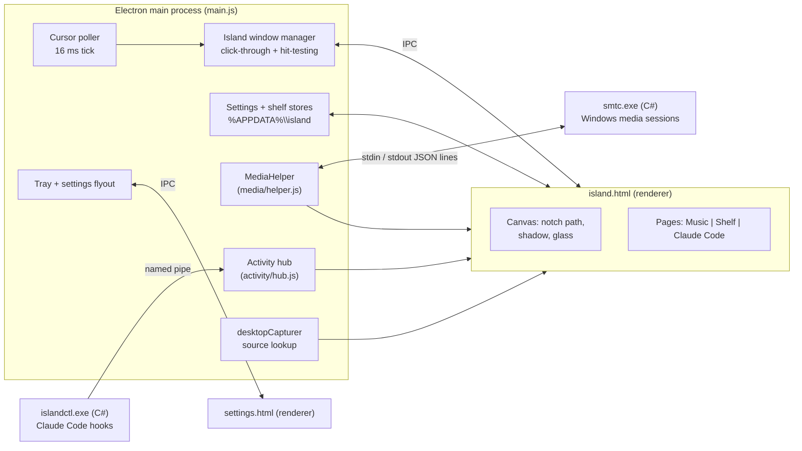
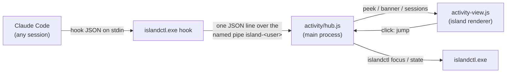

# Architecture

island is an Electron app with one always-on-top, transparent, click-through window at the top of the screen, a main process that watches the cursor, and two small C# helpers compiled with the C# compiler that ships with Windows.

- [Processes](#processes)
- [The island window](#the-island-window)
- [Glass rendering](#glass-rendering)
- [Media bridge](#media-bridge)
- [Equalizer](#equalizer)
- [Pages and swiping](#pages-and-swiping)
- [File shelf](#file-shelf)
- [Claude Code sessions](#claude-code-sessions)
- [Updates](#updates)
- [Settings file](#settings-file)
- [Tray icon](#tray-icon)
- [IPC reference](#ipc-reference)
- [Repository layout](#repository-layout)

## Processes



| Process or window | Role |
|---|---|
| **Main** (`main.js`) | Polls the cursor, opens and closes the island, switches click-through, and owns the tray, settings, shelf store, media helper, activity hub and updater. |
| **Island window** (`island.html`, `preload.js`) | Frameless, transparent, always on top, `focusable: false`, `backgroundThrottling: true`, `setContentProtection(true)` in glass mode. Draws the notch on a canvas and hosts the pages. |
| **Settings flyout** (`settings.html`, `settings-preload.js`) | A 360 px frameless window with `backgroundMaterial: 'acrylic'`, placed like Windows' own tray flyouts. Hides when it loses focus. |
| **`smtc.exe`** (`media/smtc.cs`) | Child process that bridges the WinRT media APIs. Exits when its stdin closes. |
| **`islandctl.exe`** (`activity/islandctl.cs`) | Run by Claude Code hooks. Also reads the foreground window and the Do Not Disturb state, and brings a terminal to the front. |

All renderers use Electron's defaults: `contextIsolation: true`, `sandbox: true`, `nodeIntegration: false`. Each preload exposes a small `contextBridge` API (`window.island`, `window.settings`). No remote content is loaded.

## The island window

**Geometry (DIP).** The shape is 380×140. The window is 476×264: 48 px of horizontal padding and enough bottom padding for the spring overshoot, the 14 px concave ears and the drop shadow. It sits at the top center of the display under the cursor. Electron creates a frameless transparent window a few DIP wider than requested, so the bounds are set again after creation. The notch path's top edge runs 2 px above the window; on y = 0, anti-aliasing leaves the first pixel row partly transparent.

**Lifecycle and input.** The window is shown on the first open and then stays where it is, fully transparent and click-through while closed. It is not hidden, because of how Chromium handles input on Windows: when a window is hidden while Chromium still considers the page visible, Chromium hides its input child window (`Chrome_RenderWidgetHostHWND`) and only shows it again on the page-shown path. Clicks then reach the top-level window, which answers `WM_MOUSEACTIVATE` with `MA_NOACTIVATEANDEAT` (the window cannot be activated), so the button-down is discarded. Windows hides the window on its own too: display off in Modern Standby, the lock screen, a fully covering window. Keeping `backgroundThrottling` on lets Chromium see those as the page being hidden and shown, so input survives sleep. Hiding the window on close may work again with this setting but has not been re-tested.

**Open and close.** The main process polls `screen.getCursorScreenPoint()` every 16 ms.

| Parameter | Value |
|---|---|
| Hot zone | 240×3 DIP, centered on the top edge of the display under the cursor |
| Open delay | `openDelay`, default 150 ms in the hot zone (passing through to a browser tab does not open it) |
| Close delay | `closeDelay`, default 120 ms outside the shape plus a 10 px margin |
| Pinned or held | <kbd>Ctrl</kbd>+<kbd>Alt</kbd>+<kbd>I</kbd> pins it; dragging the progress bar holds it open |

**Click-through.** The window ignores the mouse by default. The tick turns mouse input on only while the cursor is inside the shape, on a peek, or during a progress-bar drag. Electron's `{ forward: true }` forwarding does not reach the page on Windows, so hit-testing is done in the main process.

**Animation.** A damped spring is integrated at startup (semi-implicit Euler, dt = 1/600 s) and sampled into a CSS `linear()` easing with 65 stops, so CSS transitions move like springs. A `requestAnimationFrame` loop reads the island's size each frame and repaints the canvas silhouette until it has been still for 6 frames.

| Spring | Stiffness | Damping | About 95% settled |
|---|---|---|---|
| Open | 240 | 21 (about 6% overshoot) | 180 ms |
| Close | 560 | 48 (critically damped) | 210 ms |

The pages use their own springs; see [Pages and swiping](#pages-and-swiping).

## Glass rendering

`backdrop-filter` has nothing to blur in a transparent window, and DWM acrylic (`backgroundMaterial`, `SetWindowCompositionAttribute`) only fills a rectangle or an aliased `SetWindowRgn` shape. island composites its own acrylic instead:

1. **Exclude itself from capture.** `setContentProtection(true)` (`WDA_EXCLUDEFROMCAPTURE`, Windows 10 2004 and later) removes the window from screen capture, so it can capture what is behind it without seeing itself. As a result, the island does not appear in screenshots or recordings in glass mode.
2. **Capture.** `desktopCapturer` finds the screen source for the display, and the renderer opens `getUserMedia({ chromeMediaSource: 'desktop' })` at a third of the display resolution and up to 15 fps. Capture starts when the island opens or a peek shows, and stops 4 s after it closes.
3. **Crop and blur.** For each captured frame, the window's region plus a margin of 2.5 blur radii is drawn into an offscreen canvas. There is nothing above the top of the display, so the first row is stretched upward to keep the blur solid at the edge. A second canvas applies `blur(22px × scale) saturate(1.4)`.
4. **Composite** inside the notch path: blurred backdrop, a `luminosity` layer, a tint, the song tint (a uniform wash plus a radial glow from the artwork), 2.2% noise, and a 1 px inner hairline that skips the top edge. The *Transparency* setting thins the luminosity and tint layers.
5. **Theme.** `SystemUsesLightTheme` and `EnableTransparency` are read from `HKCU\Software\Microsoft\Windows\CurrentVersion\Themes\Personalize` on each open and on `nativeTheme` updates. With transparency effects off, the island is solid.

The song color is the most vivid hue in a 24×24 downsample of the artwork (12 hue bins, weighted by saturation squared and mid lightness). It becomes a UI accent and a deeper material tint, and fades between tracks.

## Media bridge

`media/smtc.cs` is a C# 5 console program compiled without any SDK. `media/helper.js` runs the .NET Framework compiler that ships with Windows (`%WINDIR%\Microsoft.NET\Framework64\v4.0.30319\csc.exe`) against `System.Runtime.dll`, `System.Runtime.InteropServices.WindowsRuntime.dll` and the `Windows.Foundation`, `Windows.Media` and `Windows.Storage` contracts in `System32\WinMetadata`. `AsTask` needs the SDK's union metadata, so `IAsyncOperation<T>` is awaited by polling `Status`, with a 5 s timeout. Development builds compile it on first run into `media/bin/`; the installer ships it as `resources/smtc.exe`.

It follows `GlobalSystemMediaTransportControlsSessionManager.GetCurrentSession()`, falling back to any playing session, listens for media, playback and timeline changes, and merges bursts with a 60 ms debounce.

**stdout:** one JSON object per line.

| `type` | Fields |
|---|---|
| `state` | `app`, `title`, `artist`, `album`, `status` (`playing`, `paused`, `stopped`, `changing`, `opened`, `closed`), `position` and `duration` in ms (from the timeline's start), `updatedAt` (Unix ms of the position), `canToggle`, `canNext`, `canPrev`, `canSeek`; or `{ "type": "state", "none": true }` |
| `art` | `key` (app, title, artist, album), `mime`, `data` (base64 thumbnail, or `null`; retried on the next event when an app publishes the title before the artwork) |
| `error` | `message` |

**stdin:** one command per line: `toggle`, `next`, `prev`, `seek <ms>`.

The renderer extrapolates the position as `position + (now − updatedAt)` while playing, applies play/pause and seeks immediately, and ignores positions reported in the 1.5 s after a seek. `MediaHelper` restarts the helper with a growing delay, up to 5 times.

## Equalizer

`eq.js` moves the bars with the audio that is playing.

1. **Capture.** `getUserMedia` with `chromeMediaSource: 'desktop'` for audio is Chromium's WASAPI loopback of the default output device: the mix Windows plays, not a microphone. An audio-only request hangs, so it also asks for a 16×16, 1 fps video track and stops it at once.
2. **Analysis.** An `AudioContext({ sinkId: { type: 'none' } })`, which opens no output stream, feeds an `AnalyserNode` (FFT size 2048). Each frame, the mean power of four bands (40–160, 160–600, 600–2400 and 2400–10000 Hz) is compared with that band's own 1 s average and spread, so the bars move on loud and quiet songs alike. Rise and fall are smoothed over 30 and 90 ms.
3. **Lifecycle.** It runs while the island is open and something is playing, and stops capturing 4 s after either ends. Before the first sound, if capture fails, and after 1.5 s of silence, the bars fall back to a CSS animation.

## Pages and swiping

The island keeps one size. Music, Shelf and, when it is on, Claude Code are pages side by side. `paging.js` (no DOM; it also runs in Node for tests) moves them with a spring:

- **While the fingers are down,** a critically damped spring (ω = 34/s, at most 3000 px/s) chases the finger position, at 0.75 of the wheel deltas and at most one page from where the swipe started. Past the first or last page the pages give up to 44 px.
- **When the fingers lift,** Chromium sends one wheel event with no delta. The pages then settle (stiffness 300, damping 27) on the page that the position plus 0.12 s of finger speed points to; a quarter of a page is enough. The spring keeps its speed, capped at 1400 px/s.
- **One page per swipe.** A precision touchpad keeps sending momentum for about a second after the lift, and a quick next swipe starts before it ends. Momentum is ignored; a new swipe counts when the deltas kick back in (at least 20 and 2.5 times the previous step) or turn the other way, from 150 ms after the lift, or after a 200 ms pause. Right after a lift the momentum can jump and even switch axes, which the 150 ms covers.
- **Without a lift event** (other touchpads), the pages settle 80 ms after the last event. A mouse wheel click (`wheelDelta` a multiple of 120, unlike a touchpad's, where `wheelDelta` equals `-deltaY`) moves one page.

These values were tuned by replaying a recorded touchpad session (874 wheel events, 25 swipes, sideways and up/down) through `paging.js`: every swipe lands on the intended page, moving at most about 50 px per frame.

A shelf with more files than fit scrolls sideways, and a long session list scrolls vertically, each until its end; after that, the pages move, but not on the momentum that carried the list to its end. Once a page swipe is running, all of its events go to the pages, even if a list slides under the cursor. The shelf dot shows the number of files, and the Claude Code dot the number of sessions working or waiting. Every open starts on Music (on Claude Code when opened from a peek) without sliding; dragging a file over the island switches to Shelf.

## File shelf

- **Drop in.** The window takes the mouse while the cursor is over the shape, so OLE drags from Explorer reach Chromium's drop target. Paths come from `webUtils.getPathForFile()` in the preload. Files without a path (for example an image dragged from a browser) are sent as an `ArrayBuffer` of up to 200 MB and written to `%APPDATA%\island\shelf-files\<uuid>\<name>`.
- **Store.** `shelf.js` keeps references, not copies, in `shelf.json` (up to 50 items; the oldest are removed first). Items whose file no longer exists are removed on open and after a drag out. Only files under `shelf-files` are ever deleted by the app.

  ```json
  [{ "id": "uuid", "path": "C:\\...\\file.png", "name": "file.png", "dir": false, "temp": false, "addedAt": 1794034087404 }]
  ```
- **Thumbnails.** `nativeImage.createThumbnailFromPath` (Windows shell thumbnails for images, video and PDF), falling back to `app.getFileIcon`.
- **Drag out.** The renderer cancels Chromium's `dragstart` and asks the main process to call `webContents.startDrag({ files, icon })`. That is a real `CF_HDROP` data object, so the target decides between copy and move as it does for an Explorer drag.
- **Multi-select.** A 400 ms long press without moving, or Ctrl+click, starts selecting; clicks select and deselect; dragging a selected file drags all selected files. *Done*, a drag out or closing the island ends it. Moving within the first 400 ms starts an ordinary drag of one file.

## Claude Code sessions

The feature is on while island's hooks are in Claude Code's settings (`activity/claude-hooks.js`, which follows `CLAUDE_CONFIG_DIR`). When it is off, the hub and its pipe do not run, <kbd>Ctrl</kbd>+<kbd>Alt</kbd>+<kbd>J</kbd> is not registered, and the Claude Code page is not shown. The state is read again at startup, on each open of the island or the flyout, and after the switch changes.



1. **Hooks.** Each hook runs `islandctl.exe hook` in exec form (no shell) with `async: true`, so Claude Code never waits for it. The events are `UserPromptSubmit` (working), `Stop` and `StopFailure` (finished, or ended on an error), `Notification` (`permission_prompt` and `elicitation_dialog` mean Claude needs you; `idle_prompt`, the reminder a minute after a turn ends, is ignored), `PermissionRequest` (which tool a prompt is for), `PostToolUse`, `PostToolUseFailure` and `PermissionDenied` (Claude continued), `SubagentStop` (counted) and `SessionEnd`.
2. **`islandctl.exe`** (`activity/islandctl.cs`, C# 5, built as a GUI program so no console window flashes). `hook` reads the hook JSON and keeps only a few top-level string fields; a small scanner skips `tool_input` and `tool_response`. It finds the Claude process (the first ancestor that is not a shell) and its terminal window (`AttachConsole` and `GetConsoleWindow`; in Windows Terminal that is a hidden pseudo-console window owned by the terminal window, hence `GetAncestor(GA_ROOTOWNER)`), and writes one line to the pipe. It prints nothing, always exits 0, and stops at once if no island is listening. A run takes about 85 ms, in the background.
3. **Hub.** There is one session per `session_id`, labelled with its project folder (`island`, then `island 2` for a second session in the same folder). A session is shown as closed when its Claude process exits, and as idle after 2 minutes without events. Peeks follow these rules:
   - A finished peek shows for 5 s, only if the turn took 10 s or more and its terminal is not in front. A needs-you peek always shows and stays until that session continues, or the peek is clicked or dismissed. Removing a row from the Claude Code page removes the session in any state; it returns with its next event.
   - If island starts during a turn, the first tool, permission or subagent event of a session not known to be working starts the turn, so its finish still peeks.
   - One peek at a time, needs-you first. A needs-you peek gives way to waiting peeks after 5 s and comes back afterwards.
   - Peeks wait while `SHQueryUserNotificationState` reports a fullscreen app, a presentation or quiet time, while Do Not Disturb is on (the shell's quiet-hours WNF state, which the notification state does not include), and while the PC is locked or asleep. Waiting peeks show afterwards without a sound, and are dropped after 30 minutes.
   - While the island is open, updates show as a one-line banner instead.
   - Sounds are made with Web Audio: rising for finished, a double tap for needs-you, falling for an error. Each peek sounds at most once.
4. **Peek and page.** A peek (300×40 DIP) is the same canvas silhouette, sprung to a smaller size. The main tick gives it the mouse while the cursor is on it, and its timer pauses meanwhile. The hot zone still opens the island, on the Claude Code page while a peek shows. Clicking a peek or a row, or <kbd>Ctrl</kbd>+<kbd>Alt</kbd>+<kbd>J</kbd> (the latest session that needs you, else the latest that finished), runs `islandctl focus <hwnd>` (`AttachThreadInput` and `SetForegroundWindow`). This brings the terminal window forward, not a specific tab.

## Updates

`updater.js` updates the installed app from GitHub Releases, with no dependencies. Development copies never update themselves.

1. **Check.** A minute after start and then every 6 hours (with *Update automatically* on), or on *Check now* in Settings, it requests `api.github.com/repos/yatinannam/island/releases/latest` through Electron's `net.fetch` (system proxy settings apply). Drafts and prereleases are ignored. A release counts when its tag `vX.Y.Z` is newer than the running version and it has an asset named `island-setup-X.Y.Z.exe`.
2. **Download.** The asset must come from `https://github.com/yatinannam/island/releases/download/`, have a plausible size, and carry the `sha256:` digest that GitHub publishes for release assets. It streams into `%TEMP%\island-update\island-setup-X.Y.Z.exe.part`, hashing as it goes; a size or SHA-256 mismatch deletes it. A verified file from an earlier run is reused.
3. **Install.** The NSIS installer runs detached with `--updated /S --force-run`: it waits for island to exit, installs silently over the same per-user folder (settings, shelf, login item and tray GUID stay, since the paths do not change) and starts island again. island then quits. This happens on *Restart* (Settings, or the tray menu's *Restart to update*), or on its own once the PC has had no input for 10 minutes while the island, a peek and the flyout are all closed.
4. **Clean up.** A minute after start, installers of the running version or older and unfinished downloads are deleted. The installer that just ran may still hold its file at startup, so this waits, and a locked file is skipped.

For tests, `ISLAND_UPDATE_URL` can point the check at a local server (`http://127.0.0.1` or `localhost` only); downloads must then come from that server. It also enables updates in a development copy.

## Settings file

`%APPDATA%\island\settings.json`, validated and clamped on load, written 400 ms after the last change.

| Key | Default | Range | Meaning |
|---|---|---|---|
| `glass` | `true` | bool | Glass or solid background |
| `transparency` | `35` | 0–100 | How much the glass shows through |
| `songColor` | `55` | 0–100 | Strength of the artwork tint (0 is off) |
| `openDelay` | `150` | 0–600 ms | Time in the hot zone before opening |
| `closeDelay` | `120` | 0–1000 ms | Time outside the island before closing |
| `claudeSound` | `true` | bool | Sounds for Claude Code peeks |
| `autoUpdate` | `true` | bool | Check for, download and install updates automatically |
| `trayPromotedGuids` | `[]` | string[] | Internal: tray icons already moved to the taskbar once |

*Start with Windows* is not stored here; it is the login item of the running executable (`app.setLoginItemSettings`). The Claude Code switch is not stored either; it reflects Claude Code's own settings. Changing a look setting keeps the island open on the primary display as a live preview until the flyout closes.

## Tray icon

- **Icon.** `icon.js` draws a screen outline with the notch from signed distance fields, 4×4 supersampled, at 16, 20, 24 and 32 px, white on a dark taskbar and near-black on a light one. The same shapes produce the app icon.
- **Identity.** Windows ties an unsigned app's tray GUID to one executable path, so the GUID is derived from `process.execPath` (SHA-1 in UUID v5 layout). The development copy, `dist\win-unpacked` and the installed app each get their own, stable across restarts.
- **Visibility.** Windows puts new tray icons in the `^` overflow. On the first run for each GUID, `tray-visibility.js` finds the icon's entry under `HKCU\Control Panel\NotifyIconSettings` by `IconGuid` (querying only that value; a full search is slow because every entry stores a PNG) and sets `IsPromoted` to 1. It checks again after 1.5 s, because Explorer may write its default just after creating the entry. After that, *Always show icon on taskbar* in the flyout or Windows' own taskbar settings control it.

## IPC reference

Island window (`preload.js`, `window.island`):

| Direction | Channel | Payload |
|---|---|---|
| renderer → main (invoke) | `snapshot` | returns `{ config, media, art, shelf, activity }` |
| main → renderer | `island-state` | `'open'` or `'closed'` |
| main → renderer | `open-page` | page for the next open (0 Music, 2 Claude Code) |
| main → renderer | `peek` / `banner` | `{ key, session, kind, label, tool, durationMs, chime }` or `null` |
| main → renderer | `activity` | `{ connected, sessions: [{ id, label, state, needsKind, tool, turnStart, durationMs, endedAt, lastEventAt, subagents, canJump }] }`; `connected` is `'off'` when the feature is off |
| main → renderer | `config` | `{ glass, dark, transparency, songColor }` |
| main → renderer | `capture` | `{ sourceId, display, window }` (bounds in DIP) |
| main → renderer | `media-state` / `media-art` | the helper's `state` / `{ key, url }` |
| main → renderer | `shelf` | `[{ id, name, dir, thumb }]` |
| renderer → main | `media-cmd` | `toggle`, `next`, `prev` or `seek <ms>` (validated) |
| renderer → main | `hold` | `boolean` (progress-bar drag) |
| renderer → main | `shape-size` | island height for hit-testing |
| renderer → main | `shelf-add` / `shelf-add-data` | `string[]` / `{ name, bytes }` |
| renderer → main | `shelf-remove` / `shelf-open` / `shelf-clear` / `shelf-drag` | id / id / none / `string[]` |
| renderer → main | `peek-click` / `peek-dismiss` / `activity-jump` / `activity-dismiss` | session id |
| renderer → main | `debug` | string, logged with `ISLAND_DEBUG=1` |

Settings flyout (`settings-preload.js`, `window.settings`): `settings-get` (invoke), `settings-set` (partial settings), `settings-action` (`quit`, `hide`, `pin`, `start-with-windows-on`/`-off`, `tray-shown-on`/`-off`, `shelf-clear`, `claude-on`/`-off`, `update-check`, `update-install`) and `settings-size` (the page's natural height). The main process sends `settings`, `settings-shown` and `settings-hiding`; the page fades its content out before the window hides.

## Repository layout

```
main.js                   main process: cursor poller, windows, tray, IPC
preload.js                window.island bridge
island.html               island renderer: canvas glass, Music, Shelf and Claude Code pages
paging.js                 page swiping: follows the fingers, settles with a spring
eq.js                     equalizer bars from system audio loopback
activity-view.js          Claude Code peeks, page, banner and sounds
activity/hub.js           Claude Code sessions and peek rules (main process, named pipe)
activity/claude-hooks.js  the Claude Code switch: island's hooks in Claude Code's settings
activity/helper.js        compiles and runs islandctl.exe
activity/islandctl.cs     hook bridge, foreground and Do Not Disturb state, window focus (C# 5)
settings.html             settings flyout
settings-preload.js       window.settings bridge
settings.js               settings store (validation, delayed save)
shelf.js                  shelf store
updater.js                updates from GitHub Releases (check, verified download, silent install)
icon.js                   tray and app icon renderer
tray-visibility.js        keeps the tray icon on the taskbar
media/smtc.cs             WinRT media bridge (C# 5)
media/helper.js           compiles, starts and reads smtc.exe
scripts/                  build-helper.js, make-icon.js, readme-images.js
docs/                     this file and the README images
```
